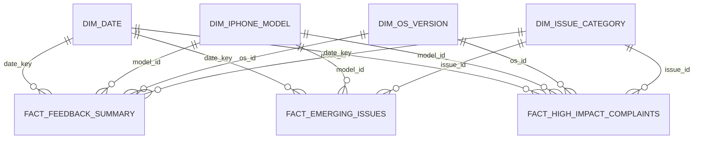

# Hướng dẫn tích hợp Backend & Frontend

Tài liệu này hướng dẫn cách Backend và Frontend sử dụng đầu ra của **Reddit iPhone Feedback Data Engineering Pipeline**.

```text
Reddit data
   ↓
Bronze
   ↓
Silver
   ↓
Gold
   ↓
PostgreSQL Serving
   ↓
Backend API
   ↓
Frontend Dashboard
```

Mục tiêu là giúp team ứng dụng sử dụng dữ liệu đã xử lý mà không cần hiểu toàn bộ phần Data Engineering.

---

## 1. Cấu hình pipeline hiện tại

Được định nghĩa trong `config/pipeline_config.py`:

```text
Silver Engine     : pyspark_roberta
Batch Gold Engine : spark_sql
Stream Engine     : apache_flink
Serving Backend   : postgres
Schema Paradigm   : galaxy
```

Lưu ý: cấu hình `apache_flink` hiện tại sử dụng logic stateful sliding-window của project để phát hiện emerging issues; nó không khởi chạy PyFlink runtime thực sự.

PostgreSQL là serving backend dành cho tầng ứng dụng.

---

## 2. Vai trò của từng tầng dữ liệu

### Bronze

Bronze lưu dữ liệu Reddit raw/gần raw dưới dạng Parquet.

```text
bronze/posts/
└── year=2026/
    ├── month=05/
    ├── month=06/
    └── month=07/
```

Backend và Frontend không nên truy vấn Bronze trực tiếp.

### Silver

Silver chứa dữ liệu mức từng post sau khi được làm sạch và enrich.

Các xử lý chính:

- deduplication
- khôi phục text
- trích xuất model iPhone
- trích xuất phiên bản iOS
- phân loại feature taxonomy
- phân loại issue taxonomy
- sentiment bằng RoBERTa
- nhận diện câu hỏi hỗ trợ
- phân loại support category
- tính engagement
- tính impact
- tạo thông tin ngày/tháng/năm

Các cột quan trọng:

| Cột | Ý nghĩa |
|---|---|
| `post_id` | ID post Reddit |
| `author` | Tác giả, mặc định `[unknown]` nếu thiếu |
| `title` | Tiêu đề |
| `clean_text` | Nội dung đã xử lý dùng cho NLP |
| `iphone_model` | Model iPhone được trích xuất |
| `ios_version` | Phiên bản iOS |
| `feature_category` | Nhóm tính năng |
| `issue_category` | Nhóm issue |
| `reddit_score` | Reddit score |
| `num_comments` | Số bình luận |
| `upvote_ratio` | Tỷ lệ upvote |
| `permalink` | Đường dẫn Reddit |
| `subreddit` | Subreddit |
| `created_utc` | Timestamp UTC gốc |
| `sentiment` | `POSITIVE`, `NEUTRAL`, `NEGATIVE` |
| `sentiment_score` | Điểm sentiment có dấu |
| `is_question` | Có phải câu hỏi hỗ trợ hay không |
| `support_category` | Nhóm nhu cầu hỗ trợ |
| `engagement_score` | Điểm tương tác |
| `impact_index` | Chỉ số tác động |
| `created_datetime` | Timestamp đã chuyển đổi |
| `feedback_date` | Ngày feedback |
| `feedback_year` | Năm |
| `feedback_month` | Tháng |

Công thức:

```text
engagement_score = reddit_score + 2 × num_comments
```

```text
impact_index =
log1p(max(0, engagement_score))
×
(0.5 + 0.5 × upvote_ratio)
```

`support_category` chỉ được gán khi `is_question = true`.

Backend thường không cần truy vấn Silver trực tiếp.

### Gold

Gold chứa các data mart đã sẵn sàng cho phân tích:

```text
feedback_volume
issue_summary
emerging_issues
sentiment_summary
feature_feedback
high_impact_complaints
issue_trends
model_comparison
recurring_issues
support_demand
```

### PostgreSQL Serving

Backend nên query PostgreSQL thay vì đọc S3 trực tiếp.

PostgreSQL chứa:

1. các bảng fact/dimension
2. bản sao Gold mart với prefix `gold_`

Với dashboard/API thông thường, nên ưu tiên các bảng `gold_*`.

---

## 3. Gold Mart Contract

### `gold_feedback_volume`

Mục đích: theo dõi lượng feedback theo thời gian.

Grain:

```text
feedback_date × feedback_week × subreddit
```

Các cột chính:

- `feedback_date`
- `feedback_week`
- `subreddit`
- `total_posts`
- `total_comments`
- `total_discussion_units`
- `avg_engagement_score`

Phù hợp cho KPI và biểu đồ volume.

### `gold_issue_summary`

Mục đích: phân tích issue chính.

Grain:

```text
feedback_date
× iphone_model
× ios_version
× feature_category
× issue_category
```

Các cột:

- `feedback_date`
- `iphone_model`
- `ios_version`
- `feature_category`
- `issue_category`
- `total_posts`
- `total_comments`
- `positive_count`
- `neutral_count`
- `negative_count`
- `avg_sentiment_score`
- `avg_engagement_score`

Phù hợp cho issue ranking và drill-down.

### `gold_emerging_issues`

Mục đích: phát hiện emerging issue.

Grain:

```text
feedback_date
× iphone_model
× feature_category
× issue_category
```

Các cột:

- `feedback_date`
- `iphone_model`
- `feature_category`
- `issue_category`
- `daily_volume`
- `epoch_days`
- `curr_3d_avg`
- `base_14d_avg`
- `base_14d_std`
- `growth_rate_pct`
- `z_score`
- `is_anomaly`

Quy tắc anomaly hiện tại:

```text
curr_3d_avg >= 2
AND
(
    growth_rate_pct >= 150
    OR
    z_score >= 2
)
```

### `gold_sentiment_summary`

Grain:

```text
feedback_date × iphone_model × sentiment
```

Các cột:

- `feedback_date`
- `iphone_model`
- `sentiment`
- `post_count`
- `mean_sentiment_score`

### `gold_feature_feedback`

Grain:

```text
feature_category × issue_category
```

Các cột:

- `feature_category`
- `issue_category`
- `mention_count`
- `negative_mentions`
- `positive_mentions`
- `negative_ratio_pct`
- `avg_engagement`

Công thức:

```text
negative_ratio_pct =
negative_mentions / mention_count × 100
```

### `gold_high_impact_complaints`

Chứa các post `NEGATIVE`, giới hạn top 500 theo engagement.

Các cột:

- `post_id`
- `feedback_date`
- `iphone_model`
- `ios_version`
- `feature_category`
- `issue_category`
- `title`
- `permalink`
- `reddit_score`
- `num_comments`
- `engagement_score`
- `impact_index`
- `sentiment_score`

Backend nên phân trang.

### `gold_issue_trends`

Grain:

```text
week_start × feature_category × issue_category
```

Các cột:

- `week_start`
- `feature_category`
- `issue_category`
- `weekly_volume`
- `prev_week_volume`
- `wow_growth_pct`

Công thức:

```text
wow_growth_pct =
(weekly_volume - prev_week_volume)
/
prev_week_volume
× 100
```

### `gold_model_comparison`

Grain:

```text
iphone_model × ios_version × feature_category
```

Các cột:

- `iphone_model`
- `ios_version`
- `feature_category`
- `total_feedback`
- `avg_sentiment`
- `defect_complaint_rate_pct`
- `avg_engagement`

### `gold_recurring_issues`

Grain:

```text
issue_category × feedback_year × feedback_month
```

Các cột:

- `issue_category`
- `feedback_year`
- `feedback_month`
- `issue_count`
- `active_period_count`
- `recurrence_count`
- `is_recurring`

```text
recurrence_count = active_period_count - 1
is_recurring = active_period_count >= 2
```

### `gold_support_demand`

Grain:

```text
support_category
× feedback_year
× feedback_month
× iphone_model
× ios_version
```

Các cột:

- `support_category`
- `feedback_year`
- `feedback_month`
- `iphone_model`
- `ios_version`
- `question_count`
- `avg_sentiment_score`
- `avg_reddit_score`
- `avg_num_comments`
- `avg_engagement_score`

---

## 4. PostgreSQL Serving Schema

Dimension chính:

```text
dim_date
dim_iphone_model
dim_os_version
dim_issue_category
```

Fact chính:

```text
fact_feedback_summary
fact_emerging_issues
fact_high_impact_complaints
```

Schema mặc định:

```text
galaxy
```



---

## 5. Mapping bảng cho Backend

| Use case | Bảng nên dùng |
|---|---|
| Feedback timeline | `gold_feedback_volume` |
| Issue ranking | `gold_issue_summary` |
| Emerging issue alerts | `gold_emerging_issues` |
| Sentiment dashboard | `gold_sentiment_summary` |
| Feature feedback | `gold_feature_feedback` |
| High-impact complaints | `gold_high_impact_complaints` |
| Weekly issue trends | `gold_issue_trends` |
| Model / OS comparison | `gold_model_comparison` |
| Recurring issues | `gold_recurring_issues` |
| Support demand | `gold_support_demand` |

---

## 6. Kết nối Database

Dùng biến môi trường:

```text
DB_HOST
DB_PORT
DB_NAME
DB_USER
DB_PASSWORD
DB_SSLMODE
```

Không commit credential thật.

Frontend không được kết nối trực tiếp PostgreSQL/RDS.

---

## 7. Query mẫu

### Feedback Volume

```sql
SELECT
    feedback_date,
    total_posts,
    total_comments,
    avg_engagement_score
FROM gold_feedback_volume
WHERE feedback_date BETWEEN :date_from AND :date_to
ORDER BY feedback_date;
```

### Top Issues

```sql
SELECT
    issue_category,
    SUM(total_posts) AS total_posts,
    SUM(negative_count) AS negative_posts,
    ROUND(AVG(avg_sentiment_score), 4) AS avg_sentiment
FROM gold_issue_summary
WHERE feedback_date BETWEEN :date_from AND :date_to
GROUP BY issue_category
ORDER BY total_posts DESC
LIMIT :limit;
```

### Emerging Issues

```sql
SELECT
    feedback_date,
    iphone_model,
    feature_category,
    issue_category,
    daily_volume,
    growth_rate_pct,
    z_score
FROM gold_emerging_issues
WHERE is_anomaly = TRUE
ORDER BY feedback_date DESC, growth_rate_pct DESC;
```

### High-Impact Complaints

```sql
SELECT
    post_id,
    feedback_date,
    iphone_model,
    issue_category,
    title,
    permalink,
    reddit_score,
    num_comments,
    engagement_score,
    impact_index,
    sentiment_score
FROM gold_high_impact_complaints
ORDER BY engagement_score DESC
LIMIT :limit
OFFSET :offset;
```

---

## 8. API đề xuất

Các endpoint sau chỉ là đề xuất, chưa được implement trong Data Engineering repository:

```text
GET /api/dashboard/overview
GET /api/feedback/volume
GET /api/issues
GET /api/issues/emerging
GET /api/sentiment
GET /api/features
GET /api/models/comparison
GET /api/complaints/high-impact
GET /api/issues/recurring
GET /api/support-demand
```

Filter đề xuất:

```text
date_from
date_to
iphone_model
ios_version
feature_category
issue_category
sentiment
limit
offset
```

Backend nên validate input, dùng parameterized SQL và phân trang.

---

## 9. Hướng dẫn Frontend

Frontend chỉ cần làm việc với Backend API.

Các section dashboard đề xuất:

```text
Overview
Sentiment
Issues
Emerging Issues
Feature Feedback
Model / OS Comparison
High Impact Complaints
Recurring Issues
Support Demand
```

| Metric | Ý nghĩa | UI phù hợp |
|---|---|---|
| `total_posts` | Số feedback post | KPI / line chart |
| `total_comments` | Số comment | KPI |
| `avg_engagement_score` | Mức tương tác trung bình | KPI |
| `negative_ratio_pct` | Tỷ lệ feedback tiêu cực | bar / progress |
| `defect_complaint_rate_pct` | Tỷ lệ complaint tiêu cực | comparison bar |
| `growth_rate_pct` | Tăng trưởng so với baseline | trend badge |
| `z_score` | Độ lệch thống kê | anomaly indicator |
| `is_anomaly` | Cờ emerging issue | warning badge |
| `weekly_volume` | Số issue theo tuần | line chart |
| `wow_growth_pct` | Tăng trưởng WoW | trend badge |
| `question_count` | Số câu hỏi hỗ trợ | KPI / bar |
| `recurrence_count` | Số lần tái xuất hiện sau lần đầu | recurrence indicator |
| `impact_index` | Chỉ số tác động | complaint priority |
| `engagement_score` | Reddit score + trọng số comment | ranking |

Định dạng đề xuất:

- ngày: `YYYY-MM-DD`
- phần trăm: `12.34%`
- sentiment: `POSITIVE`, `NEUTRAL`, `NEGATIVE`
- xử lý `NULL`, `Unknown`, `[unknown]` an toàn
- nếu không có dữ liệu thì trả empty state

Ví dụ:

```json
{
  "data": [],
  "total": 0
}
```

---

## 10. Bảo mật

Backend:

- giữ PostgreSQL credentials
- query PostgreSQL
- expose API
- validate filter
- dùng parameterized SQL

Frontend:

- không nhận DB credentials
- không kết nối RDS trực tiếp
- chỉ gọi Backend API

Không expose:

```text
AWS_ACCESS_KEY_ID
AWS_SECRET_ACCESS_KEY
DB_PASSWORD
private RDS credentials
```

---

## 11. Cách refresh pipeline

Implementation hiện tại:

```text
new Bronze data
    ↓
rerun Silver
    ↓
rerun Gold
    ↓
rerun Serving
```

Silver và Gold dùng overwrite-style writes.

Serving dùng:

- `INSERT ... ON CONFLICT`
- replace các Gold serving table

Đây chưa phải incremental production pipeline hoàn chỉnh.

---

## 12. Query kiểm tra Serving

```sql
SELECT COUNT(*)
FROM fact_feedback_summary;
```

```sql
SELECT COUNT(*)
FROM gold_issue_summary;
```

```sql
SELECT COUNT(*)
FROM gold_support_demand;
```

Liệt kê Gold serving table:

```sql
SELECT table_name
FROM information_schema.tables
WHERE table_schema = 'public'
  AND table_name LIKE 'gold_%'
ORDER BY table_name;
```

Snapshot gần nhất:

```text
fact_feedback_summary: 4272
fact_emerging_issues: 2056
fact_high_impact_complaints: 500

gold_feedback_volume: 92
gold_issue_summary: 4272
gold_emerging_issues: 2056
gold_sentiment_summary: 3138
gold_feature_feedback: 12
gold_high_impact_complaints: 500
gold_issue_trends: 162
gold_model_comparison: 771
gold_recurring_issues: 33
gold_support_demand: 1185
```

Các giá trị trên chỉ là snapshot kiểm tra, không phải row count cố định.

---

## 13. Ranh giới trách nhiệm

```text
Data Engineering → analytical data contracts
Backend          → API contracts
Frontend         → UI consumption
```

Backend nên bắt đầu từ các bảng `gold_*`. Chỉ dùng fact/dimension khi cần truy vấn đa chiều phức tạp hơn.
